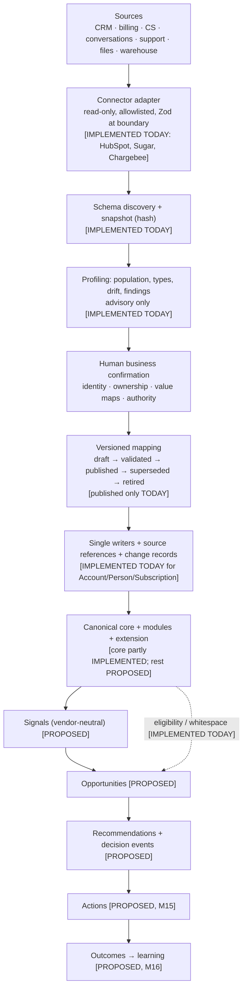
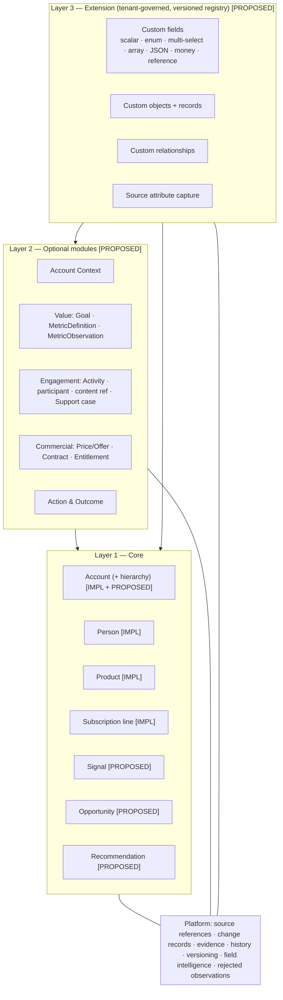
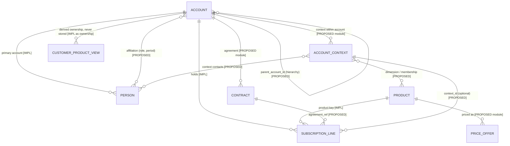
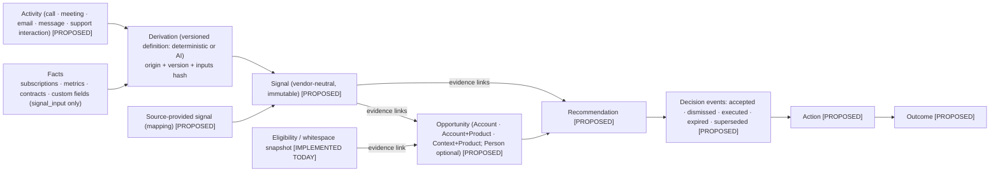
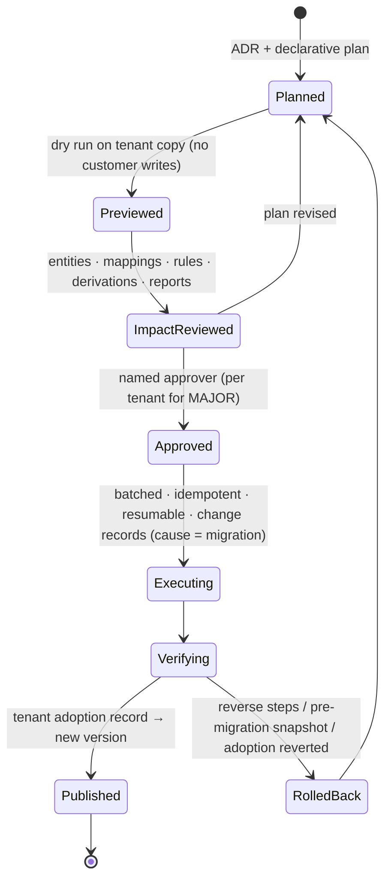

# Canonical Architecture v1 Candidate (M9E-J)

- Status: **CANDIDATE — not Canonical Model v1.0.** It is eligible for the v1.0 freeze only after:
  - M9C (file/S3) and M9D (warehouse/table) pressure-test it;
  - the relocated M9 §13.5 freeze gate passes (owner decision 4).
- Milestone: M9E (design/documentation only). **No schema, table, migration or code was changed.**
- Base: `main` at `a9c0133`.
- Decision record: [ADR 0025](../../adr/0025-canonical-architecture-v1-candidate.md).
- Parts:
  - [E1 inventory](01-inventory.md);
  - [E2 classification and promotion rule](02-classification-and-promotion-rule.md);
  - [E3 entity specifications and relationship matrix](03-entity-specifications.md);
  - [E4 extension framework](04-extension-framework.md);
  - [E5 source reference, provenance, history](05-source-reference-and-provenance.md);
  - [E6 versioning and migration](06-versioning-and-migration.md);
  - [E7 data quality and structured values](07-data-quality-and-structured-values.md);
  - [E8 pressure-test matrix](08-pressure-test-matrix.md).
- Labels:
  - `IMPLEMENTED TODAY`: code, schema and tests on `main`;
  - `DOMAIN-ONLY`: a Zod schema exists but is unused and unpersisted;
  - `PROPOSED FOR V1 CANDIDATE`: specified here, not built;
  - `DEFERRED`.

## 1. The candidate in one page

| Layer                     | Contents                                                                                                                                                                                                                   | Status                                                                                                                                                                                                                                                    |
| ------------------------- | -------------------------------------------------------------------------------------------------------------------------------------------------------------------------------------------------------------------------- | --------------------------------------------------------------------------------------------------------------------------------------------------------------------------------------------------------------------------------------------------------- |
| **Core**                  | Account (+ `parent_account_id`), Person (+ affiliation), Product, Subscription line (+ `agreement_ref`), Signal, Opportunity (+ lines), Recommendation (+ decision events)                                                 | Account, Person, Product, Subscription line: `IMPLEMENTED TODAY`. Hierarchy, affiliation, `agreement_ref`, Signal, Opportunity, Recommendation: `PROPOSED FOR V1 CANDIDATE` (M1 Signal/LeadCandidate/QualificationDecision are `DOMAIN-ONLY`, superseded) |
| **Optional modules**      | Account Context; Value (Goal, MetricDefinition, MetricObservation); Engagement (Activity, participant, content reference, Support case); Commercial (Price/Offer, Contract/Agreement, Entitlement/Asset); Action & Outcome | all `PROPOSED FOR V1 CANDIDATE` (Support case, Entitlement, Action, Outcome: specification only)                                                                                                                                                          |
| **Extension**             | custom fields (scalar, enum, multi-select, array, JSON, money, reference), custom objects, custom relationships, source attribute capture — one versioned tenant registry                                                  | `PROPOSED FOR V1 CANDIDATE` (nothing stored today; `attribute` mapping kind reserved)                                                                                                                                                                     |
| **Platform**              | source references, change records, evidence links, history policy, field intelligence, rejected observations, canonical version + tenant adoption, mapping lifecycle, migration framework                                  | references and change log `IMPLEMENTED TODAY` (partial); rest `PROPOSED FOR V1 CANDIDATE`                                                                                                                                                                 |
| **Derived**               | ownership, eligibility, whitespace, CustomerProduct view, hierarchy roll-ups, health status                                                                                                                                | ownership/eligibility/whitespace `IMPLEMENTED TODAY`; others `PROPOSED FOR V1 CANDIDATE` (derived, never stored)                                                                                                                                          |
| **Rejected / superseded** | BusinessOutcome entity, Health entity, Conversation entity, vendor-specific canonical objects, Lead/LeadCandidate                                                                                                          | —                                                                                                                                                                                                                                                         |
| **Deferred**              | Order (extension until promoted), internal user/team, segment, campaign, invoice/payment, bitemporal history, multi-currency FX                                                                                            | `DEFERRED`                                                                                                                                                                                                                                                |

## 2. Diagrams

### Diagram 1 — Platform flow

### Diagram 2 — Three-layer canonical architecture

### Diagram 3 — Account / Context / Product / Subscription model

### Diagram 4 — Activity → Signal → Opportunity → Recommendation

### Diagram 5 — Canonical version migration lifecycle

## 3. Answers to the brief's 20 questions

| #   | Question                                                         | Answer (section)                                                                                                                                                                                                                                                                                                 |
| --- | ---------------------------------------------------------------- | ---------------------------------------------------------------------------------------------------------------------------------------------------------------------------------------------------------------------------------------------------------------------------------------------------------------- |
| 1   | What belongs in the minimal core?                                | Account (+ hierarchy), Person, Product, Subscription line, Signal, Opportunity, Recommendation (E2 §2). The first four are `IMPLEMENTED TODAY`                                                                                                                                                                   |
| 2   | What belongs in optional modules?                                | Account Context; Value; Engagement; Commercial; Action & Outcome (E2 §2, E3 §9–13)                                                                                                                                                                                                                               |
| 3   | What must remain extension data?                                 | Anything failing the promotion test: tenant-specific fields, custom objects (orders until promoted, inspections, projects), source-captured attributes (E2, E4)                                                                                                                                                  |
| 4   | What exactly is Relationship / AccountContext?                   | A managed business context within one account (Account + Product + Region, BU, workspace, programme, service/contract), with its own owner, goals, health, renewal, signals and opportunities; optional module (E3 §10)                                                                                          |
| 5   | How is hierarchy different from Relationship?                    | Hierarchy: account under account (`parent_account_id`, acyclic, authority-governed). Context: a scope inside one account. Never interchangeable (E3 §1, §10)                                                                                                                                                     |
| 6   | How do Goals / Outcomes / Metrics work?                          | Goal (scope, status, target metric + window, origin, owner); MetricDefinition (registry); MetricObservation (immutable time series); BusinessOutcome folded into Goal; health = metric/signal (E3 §11)                                                                                                           |
| 7   | How do Gong / Fireflies / Gmail / Calendar fit without redesign? | One Activity model (+ participants, content references, threads) in the Engagement module; interpretation via versioned derivations into Signals; vendor in provenance (E3 §12, E8)                                                                                                                              |
| 8   | How do custom objects fit?                                       | Registry definitions + records + relationships in typed stores, with limits, single writer and provenance; promotion path (E4 §2–§3, §7)                                                                                                                                                                         |
| 9   | How do JSON / arrays / multi-selects fit?                        | Decision order: canonical collection → normalized child records → extension collection → extension JSON → source payload reference; never blind stringify (E7 §4, E4 §3)                                                                                                                                         |
| 10  | What causes a new canonical version?                             | Additive model changes → MINOR; breaking changes (remove/rename/change meaning/require/narrow/closed-enum semantics) → MAJOR (E6 §2)                                                                                                                                                                             |
| 11  | What does not?                                                   | Custom fields/objects, product models, mappings, connectors/adapters, tenant signal types/metrics, derivation versions, data-quality policy (E6 §2)                                                                                                                                                              |
| 12  | How are mappings migrated?                                       | Re-validated per canonical version; MINOR keeps them valid; MAJOR generates mapping migration proposals → human publishes new mapping versions within the compatibility window; lifecycle draft → validated → published → superseded → retired (E6 §4)                                                           |
| 13  | How is rollback handled?                                         | Schema forward-fix in production (unchanged policy); data rollback by reverse steps or pre-migration tenant snapshot; adoption rollback within the compatibility window (E6 §5)                                                                                                                                  |
| 14  | How are source identities separated from canonical identity?     | Platform UUIDs; source references `(system, object, external id)` with lifecycle; one reference → one record; one record → many references (E5 §1–§2; `IMPLEMENTED TODAY` for accounts/persons/lines)                                                                                                            |
| 15  | How is historical data retained?                                 | Per-entity history policy: immutable records; projection + value history for business-critical fields; projection + change log elsewhere; tombstones, never physical deletion by ingestion (E5 §4)                                                                                                               |
| 16  | How is every important fact traced to evidence?                  | Widened change record (source, run, mapping, schema snapshot, transforms, origin, derivation, actor, canonical version) + immutable evidence links (E5 §3)                                                                                                                                                       |
| 17  | Can files and warehouse tables map into the architecture?        | Yes by design (E8): rows → core/custom objects/metrics via mapping; completeness via manifest/count proofs. **To be proven by M9C/M9D** before the freeze                                                                                                                                                        |
| 18  | Can new systems be added primarily through adapter + mapping?    | Yes: 19 systems tested, none needed a new core entity; changes forced were additive and are in the candidate (E8 §2)                                                                                                                                                                                             |
| 19  | What still requires human semantic confirmation?                 | Identity fields, holding/ownership semantics and reviewed domains, value maps, authority, stable-snapshot acceptance, eligibility / signal-input / AI uses of extension fields, AI-suggested goals/definitions/mappings, per-tenant semantic choices (Lead object, CTA, scores-as-signals) (ADR 0025 §12, E8 §2) |
| 20  | What is intentionally deferred?                                  | Order, internal user/team, segment, campaign, invoice/payment, bitemporal history, multi-currency FX, physical table designs, all implementation (E1, E2 §Deferred)                                                                                                                                              |

## 4. Preserved guarantees (M7–M9B), and how the candidate keeps them

| Guarantee (`IMPLEMENTED TODAY`)                                       | How the candidate preserves it                                                      |
| --------------------------------------------------------------------- | ----------------------------------------------------------------------------------- |
| Product key identity, K1–K4, product model versioning                 | Product unchanged; Price/Offer separate and never used for ownership                |
| Subscription line identity (`<subscription>:<item_price>` etc.)       | Line stays the canonical Subscription; `agreement_ref` is additive                  |
| Derived ownership; `unknown` never owned                              | CustomerProduct is a derived view; entitlements only via a future evaluator version |
| Eligibility, whitespace, coverage tiers, `stable_snapshot` acceptance | unchanged; Signals/Opportunities cite eligibility snapshots as evidence             |
| Reviewed holding domain; seen-but-rejected protection                 | unchanged; rejected observations add observability, never tombstones                |
| Full-read proof; retirement only on accepted full runs; G4            | unchanged; generalised as the reference lifecycle rule (E5 §2)                      |
| One authoritative source per fact                                     | extended with new facts (e.g. `account_hierarchy`) — same rule                      |
| Single writers; provenance with connection + mapping version          | every new entity gets a single writer; change record widened, not duplicated        |
| Tenant isolation (ADR 0008)                                           | every new store tenant-owned, forced RLS, tenant-scoped keys, schema guard          |
| Immutable versioned documents with base version                       | reused for extension, signal type, metric and action-type registries                |

## 5. What this candidate is not

- It is **not** Canonical Model v1.0. It is **not** frozen.
- It is **not** an implementation. No table, column, migration or code exists for anything labelled
  `PROPOSED FOR V1 CANDIDATE`.
- It does **not** resolve the open items. They stay open and separate:
  - tech debt #62 (intermittent SIGTERM runtime check), #63 (Sugar unchanged not reproduced end to end), #64 (legacy
    Chargebee mapping recapture/republish not reproduced);
  - live Chargebee mutations M09/M10 not run;
  - V6, V9, V10, V11 unresolved;
  - Chargebee incremental sync disabled;
  - live Sugar verification pending.

## 6. Next steps

- **E11:** consistency verification.
- **E12:** independent review, owner approval, PR, merge.
- **M9C** and **M9D:** pressure tests against this candidate.
- **v1.0 freeze gate:** the relocated M9 §13.5 gate.
- Implementation per entity in its milestone, each with its own plan.
